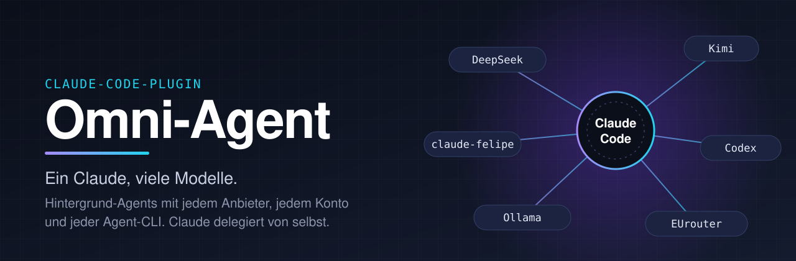
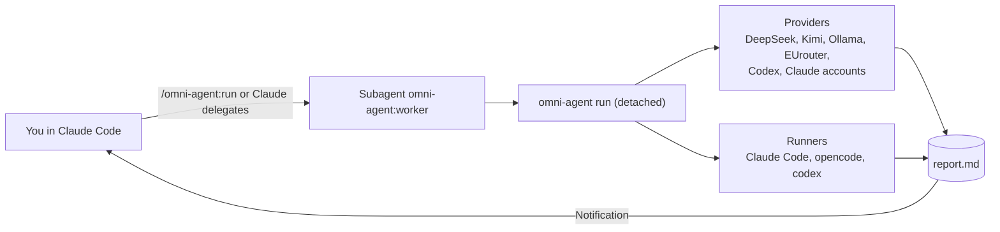

<p align="center">
  
</p>

<p align="center">
  <a href="LICENSE"></a>
  
  
  
  
  
</p>

<p align="center">
  <b>Your Claude hands tasks to other models, other accounts and Codex, in the background, without you waiting.</b><br>
  DeepSeek, Kimi, Ollama, EUrouter, Codex and any number of Claude accounts. One command, one report.
</p>

<p align="center">
  <a href="#install">Install</a> ·
  <a href="#what-it-looks-like">Demo</a> ·
  <a href="#what-you-get">Features</a> ·
  <a href="#quality-per-provider">Quality per provider</a> ·
  <a href="#usage">Commands</a> ·
  <a href="docs/02-architecture.md">Architecture</a> ·
  <a href="CHANGELOG.md">Changelog</a>
</p>

---

## Why Omni-Agent?

- **Parallel instead of sequential.** Research, comparison, a second opinion or a draft run in the background while your main Claude keeps working. When the run ends, you get a notification.
- **The right model for the job.** Cheap and fast with DeepSeek, local and private with Ollama, EU-hosted with EUrouter, a second opinion from Codex or from another Claude account with its own quota.
- **Claude decides on its own.** The subagent `omni-agent:worker` is described so that Claude calls it by itself, also inside a `/goal`. Claude never picks a third-party provider without asking.
- **Built to be safe.** Clean environment per run, only the one key it needs, no shell by default, a secrets block in review. Keys live in a file with mode 600 and never pass through the chat.
- **Zero dependencies.** Python standard library, one plugin, no server, no database.

## What it looks like

*Examples, output shortened.*

```text
> /omni-agent:run --account felipe Compare three methods for assuring teaching quality

● omni-agent:worker   Started: 20261111-004456-claude-felipe (process 48213, detached)
  … you keep working …
● Run done: report.md is ready
  Result · Findings or details · Evidence · Assumptions and open points
```

```text
> /omni-agent:review --account fbs --adversarial

## Verdict
needs-work, one critical finding

### [critical] Token is printed to the log
- Location: lib/auth.py:88   - Confidence: 0.9
- Recommendation: Redact the value before writing it
```

## What you get

| | |
|---|---|
| **Delegation by itself** | The subagent `omni-agent:worker` takes on well-bounded subtasks; `/omni-agent:run` starts it on request |
| **Background runs** | Detached processes, `status`, `result`, `cancel`, a notification at the end, assignment to the Claude session |
| **Review with a second opinion** | Git diff to another model or account, fixed report schema, `adversarial-review` challenges the solution |
| **Project mode** | The agent works in the real project folder, read-only or with `--write`, without commit or push |
| **Review gate** | Optional (off): a second model checks unreviewed changes before a session ends |
| **Any number of Claude accounts** | Each with a name, a key and its own quota, with a usage display (`/omni-agent:accounts`) |
| **Swappable agent CLI** | Claude Code, opencode, codex, dsh. Omni-Agent checks which CLI fits which provider |
| **Your own providers** | One JSON file in `~/.omni-agent/providers.d/` is enough |



## Install

**Fastest way:** Give Claude Code this repo address and say "Install this for me". Claude then follows [INSTALL.md](INSTALL.md).

**As a Claude Code plugin:**

```text
/plugin marketplace add alexodexo/omni-agent
/plugin install omni-agent@omni-agent
/omni-agent:setup
```

**Without the plugin** (also without Claude, in a terminal): clone the repo, then run `bin/omni-agent setup`. Requirements: Python 3.9 or newer (macOS, Linux, WSL) and at least one agent CLI (default: [Claude Code](https://claude.com/claude-code)).

## Quality per provider

Runs, reports, background, `status`/`result`/`cancel`, session assignment and review are **the same path for all providers**. Differences exist only where a provider technically cannot do something:

| Capability | Claude accounts | Codex (login) | DeepSeek, Kimi, Ollama, OpenRouter | EUrouter, Nvidia |
|---|:-:|:-:|:-:|:-:|
| Background run, report, notification | ✅ | ✅ | ✅ | ✅ |
| Run on another machine (`--host`) | ✅ | ✅ | ✅ | ✅ |
| Review and adversarial review | ✅ | ✅ | ✅ | ✅ |
| Follow-up to the same agent (`--resume`) | ✅ | ✅ | ✅ with runner `claude` | – |
| **Project mode** (in the real project, read-only or writing) | ✅ | ✅ | ✅ | ✅ |
| Show usage and balance (`/omni-agent:usage`) | ✅ limits | ✅ limits, plan, credits | ✅ balance (DeepSeek, Kimi, OpenRouter) | ✅ balance (EUrouter) |
| **Live tested** | ✅ | ✅ | DeepSeek only | no |

Project mode works with every provider; the decision is yours. It sends files from your project to the chosen provider; `omni-agent providers` shows the data location. What "live tested" means, and what is only built from vendor documentation, is in the [provider table](#providers-and-privacy).

## Usage

| Command in the Claude chat | Purpose |
|---|---|
| `/omni-agent:run [--background\|--foreground] [--account NAME \| --provider ID] [--project] [--write] [--resume\|--new] <task>` | Hand a task to a run with another model, another Claude account or Codex. Default: in the background, you get notified |
| `/omni-agent:review [--base main] [--account NAME] [focus]` | Have another model review your git changes (verdict, findings by severity) |
| `/omni-agent:adversarial-review [focus]` | The same, but adversarial: challenges the chosen solution |
| `/omni-agent:status [run] [--all]` | Table of the runs of this session |
| `/omni-agent:result [run]` | The report of a run, unchanged |
| `/omni-agent:cancel [run]` | Cancel a running run |
| `/omni-agent:usage [target]` | Usage and balance of all providers: Claude limits, Codex limits with plan, DeepSeek, Kimi, OpenRouter and EUrouter balances |
| `/omni-agent:hosts [test NAME]` | Remote targets (Mac mini, server) for `--host` |
| `/omni-agent:accounts` | Claude accounts with usage (5 hours, 7 days) and default |
| `/omni-agent:setup [--provider ID] [--review-gate on\|off]` | Setup, instructions for a provider, review gate |
| `/omni-agent:doctor` | What is there, what is missing |

### How Claude works with Omni-Agent

These files in the plugin define **how** Claude deals with Omni-Agent (there is no central "instructions file"; a plugin does not load `CLAUDE.md`):

| File | Role |
|---|---|
| `agents/worker.md` | The subagent `omni-agent:worker`: a thin forwarder. **Its description is the trigger**: Claude may call it on its own when a larger, well-bounded subtask should go to another model, account or Codex. You do not have to say "Omni-Agent", not even in a `/goal`. Claude never picks a third-party provider on its own |
| `commands/*.md` | The slash commands. `run` calls the subagent; `status`, `result`, `cancel`, `doctor`, `accounts` run the command directly (no model in between) |
| `skills/omni-agent-runtime` | Internal contract of the subagent: exact command syntax, wait loop, project mode |
| `skills/omni-agent-task` | Internal guide for writing a task (goal, context, done criterion, limits) |
| `skills/omni-agent-results` | Internal rules for passing results on (findings first, guesses marked, stop after a review, no invented substitute on errors) |
| `hooks/hooks.json` | Assigns runs to a Claude session, cleans up on exit, optional review gate |

**Runs belong to the session.** `status`, `result`, `cancel` and the question "resume or start new?" refer first to runs of the current Claude session. When the session ends, its still-running runs are stopped (not on `/clear`); reports stay in place.

**Project mode.** `--project` lets the agent work in the project folder (read-only; `--write` allows changes, without commit and push). This works with every provider; with third-party providers, the files read go to their data location. The report is the agent's final answer; no report file is left behind in the project.

**Review gate (off until you switch it on).** `/omni-agent:setup --review-gate on`: before a Claude session ends, the default account checks every new state of unreviewed changes and can hold the exit once. Without changes no model is called; the same diff is never checked twice, at most three blocks per session, and with secrets in the diff or on errors it lets the session through. This costs usage, and the diff leaves your machine.

In the terminal:

```bash
omni-agent run --provider deepseek --text "Compare three methods for assuring teaching quality"
omni-agent run --provider nvidia --runner opencode task.md
omni-agent status
omni-agent result                         # report of the last run
omni-agent run --resume --text "And what about X?"   # follow-up to the same agent
omni-agent cancel                         # cancel the running run
omni-agent review --account fbs --base main --adversarial   # second opinion on the changes in the repo
omni-agent run --background --account felipe --text "…"   # start detached, the run name comes back at once
omni-agent wait --max 540                                 # wait for the run, then state or report
omni-agent run --project --account fbs --text "Why does the login hang?"   # in the current project, read-only
```

**Review:** `omni-agent review` sends the git diff (all changes against HEAD; with a clean working tree, the branch against the main branch; or `--base main`) to another model or account and returns a verdict (`approve` or `needs-work`), findings by severity with file, line and confidence, and next steps. `--adversarial` additionally challenges the chosen solution; free text after it sets the focus. The diff leaves your machine: `--preview` shows beforehand what would be sent. If the diff contains possible secrets or `.env` files, **nothing** is sent (only `--force` overrides this). Lock files and diffs over 400 KB are excluded. The reviewer changes nothing in the code; findings are hints, not truth.

**Follow-ups:** `--resume` continues the run with the same agent history (Claude and Codex), in the same folder; `report.md` is updated. Provider and runner stay those of the run.

## Usage and balance

`omni-agent usage` (or `/omni-agent:usage`) shows what each provider offers; all queries run in parallel:

```text
claude-fbs       5 h 2%, reset Wed 03:00 (in 1 h 25 min)  |  7 days 73%, reset Thu 10:00 (in 1 d 8 h)
codex            Plan prolite  |  7 days 1% used, reset Mon 16 Nov 23:20 (in 5 d 21 h)  |  2 reset credits available
deepseek         Balance 9.18 USD (topped up 9.18)
```

| Provider | Source | Shown |
|---|---|---|
| Claude accounts | Rate-limit headers of a one-token request | Usage for 5 hours and 7 days with reset; for API keys, free requests and tokens |
| Codex | `codex app-server` (login of the Codex CLI itself) | Plan, usage per time window with reset, credits, reset credits, block |
| DeepSeek, Kimi, OpenRouter, EUrouter | Balance query of the provider | Balance with currency |
| Ollama, Nvidia, custom providers | – | explicitly says "no query known" or "runs locally" |

The key goes only to the provider it belongs to. Live tested: Claude accounts, Codex and DeepSeek. Kimi, OpenRouter and EUrouter are built from their documentation. With `--host mini` you query the accounts and logins on another machine.

## Running on other machines

Mac mini, Linux server, cloud VM: anything `ssh` can reach. Tailscale addresses and MagicDNS names work the same way (Tailscale SSH without a key too). The command runs **there**; keys, agent CLIs, projects and runs stay there, nothing is transferred.

```bash
omni-agent host add mini --ssh alex@mini.tailnet-name.ts.net    # or a Tailscale IP
omni-agent host install mini      # fetches Omni-Agent via git into ~/.omni-agent-app on the target
omni-agent host setup mini        # set up keys and logins there (in your own terminal)
omni-agent host test mini         # ssh reachable, runners, providers

omni-agent run --host mini --provider codex --wait 540 --text "Summarize the logs"
omni-agent run --host mini --project ~/projects/app --account fbs --text "Why does the login hang?"
omni-agent status --host mini
omni-agent usage --host mini
```

- `--host` works with `run`, `status`, `result`, `cancel`, `wait`, `usage` and `doctor`. Background, notification and `--wait` work as they do locally; if the ssh connection drops, the run keeps going on the target.
- With `--project`, the folder is a path **on the target**. `--files` and `review` need local files and do not work with `--host`.
- A local task file is sent along as text.
- Requirements on the target: Python 3.9 or newer, `git` (only for `host install`) and an agent CLI. Login by key or Tailscale SSH, without a password prompt.
- Live tested: Mac mini over a Tailscale address with a Codex login.

**Claude in the cloud:** `claude --cloud` starts a session at Anthropic against a GitHub repository. That is a different model than a run with a report and therefore not yet a `--host` target. Your own cloud machine (a VM with ssh) already works today.

## Keys: never in the chat

Keys live in `~/.omni-agent/env` (line `NAME=value`, mode 600) or in an environment variable. `omni-agent setup` creates the file; **you enter the key yourself**. Claude never asks for it and never reads the file. Omni-Agent refuses the file if others could read it.

## Providers and privacy

**Everything you write in a task goes to the provider.** Do not send participant data, credentials or internals to a provider whose data location you do not accept.

| Provider | Format | Data location | Live tested | Key |
|---|---|---|---|---|
| **deepseek** | Anthropic | **China**, training intended | yes | `DEEPSEEK_API_KEY` |
| **openrouter** | Anthropic | not documented | no | `OPENROUTER_API_KEY` |
| **kimi** | Anthropic | not documented | no | `MOONSHOT_API_KEY` |
| **ollama** | Anthropic | **local**, stays on the machine | no | none |
| **eurouter** | OpenAI | EU (per provider) | no | `EUROUTER_API_KEY` |
| **nvidia** | OpenAI (chat only) | not documented | no | `NVIDIA_API_KEY` |
| **claude-account** | Anthropic | Anthropic | no | `ANTHROPIC_API_KEY` |
| **codex** (OpenAI login) | OpenAI | OpenAI | yes | none: `codex login` |
| **claude-NAME** (own accounts) | Anthropic | Anthropic | no | `OMNI_AGENT_ACCOUNT_NAME` |

"No" means: built from vendor documentation (as of 28 Oct 2026), but not tried by us. For personal data: `ollama` or `eurouter`. Custom providers: a JSON file in `~/.omni-agent/providers.d/` (same schema as [providers.json](providers.json)).

### Codex (OpenAI)

`--provider codex` uses **the login of the Codex CLI itself**, that is your ChatGPT account or your OpenAI key from `codex login`. Omni-Agent stores nothing for it. Requirement: `codex` is installed and logged in; `omni-agent doctor` shows it as logged in. If it does not find `codex` in the PATH, it looks in the ChatGPT app (`/Applications/ChatGPT.app/…/codex-cli`); with `OMNI_AGENT_CODEX=/path/to/codex` you set the location yourself.

- **Only** the login applies, not your personal `config.toml` and your rules (`--ignore-user-config --ignore-rules`). You give model and effort: `--model small|default|strong` or a model name, `--effort low|medium|high`.
- Codex runs in its sandbox (`workspace-write`): it writes only in the run folder, and shell commands have no network. Its shell is therefore always there and is listed in the tools line.
- Your Codex quota counts too. With `luna` (`--model small`) and `--effort low` it stays cheap.
- Codex with a **third-party provider** (e.g. EUrouter over the Responses API) is built but not live tested.

### Named Claude accounts

As many accounts as you like, each with its own name and its own quota:

```bash
omni-agent account add felipe --kind token --title "Felipe's account"   # asks for the key invisibly
omni-agent account add fps --kind api
omni-agent account list                                                  # also shows usage (limits)
omni-agent run --provider claude-felipe --text "…"                      # or /omni-agent:run claude-fps …
omni-agent account remove fps --with-key
```

- **Name:** lowercase letters, digits, hyphen. The provider is then called `claude-<name>`; the key is stored in `~/.omni-agent/env` as `OMNI_AGENT_ACCOUNT_<NAME>` (mode 600).
- **Kind:** `api` is recommended (`ANTHROPIC_API_KEY`). A subscription token (`--kind token`, `CLAUDE_CODE_OAUTH_TOKEN`) for unattended runs is not expressly regulated by Anthropic; whether that is allowed is **not documented**. The decision is yours.
- **Never put a key in the chat.** `account add` asks in your own terminal, or you enter the line in the file yourself. An existing line you adopt with `--adopt CLAUDE_CODE_OAUTH_TOKEN`.
- **Usage in `account list`:** per subscription account, usage of the 5-hour and 7-day limit with reset time; for API keys, the free requests and tokens. This costs one one-token request per account (Haiku) and is read from the rate-limit headers; `--no-usage` skips it. Live tested only for subscription tokens; for API keys the header names follow Anthropic's docs, untested. These headers do not reveal the account type (Pro, Max). An empty window ("5 h –") means: none is running right now.
- **Default account:** `omni-agent account default fbs` sets what runs without `--provider`. Short form for another account: `--account felipe`. Third-party providers such as DeepSeek are never chosen as the default unless you set it yourself.
- Accounts run only with the runner `claude`. The provider `claude-account` remains as a single-account shortcut (`ANTHROPIC_API_KEY`).

## Providers and runners must match

Each provider speaks one format, each CLI understands only some.

| Provider | claude | opencode | codex |
|---|---|---|---|
| deepseek, openrouter, kimi, ollama | yes | yes | no |
| eurouter | only with LiteLLM | yes | yes (Responses path untested) |
| nvidia | only with LiteLLM | yes | no |
| claude-account, claude-NAME | yes | – | – |
| codex (login) | – | – | yes |

Without `--runner`, `omni-agent run` takes the first **installed** matching runner (claude, opencode, codex). `omni-agent doctor` shows the matrix for your machine. If nothing fits, it tells you what is missing.

**Runner status:** `claude` and `codex` (with a login) are live tested. `opencode` and Codex with a third-party provider are built from vendor documentation but not tried. `dsh` (DeepSeek Harness) is a developer preview and only runs if you name `--runner dsh` explicitly.

### Optional: LiteLLM as a translator

Only needed if Claude Code should run against a pure OpenAI provider. Usually `--runner opencode` is the better way. `omni-agent extras litellm install` puts LiteLLM into its own environment (pinned version, hash check); it is started with `--via-litellm`. The proxy listens only on 127.0.0.1 and gets only the one key of the provider. Background: LiteLLM version 1.107.0 was compromised on 21 Oct 2026; Omni-Agent pins to a version before it.

## Security

| Measure | Effect |
|---|---|
| Clean environment (`env -i` plus the bare minimum) | Your login and your base URL do not leak into the third-party agent |
| Only the one key needed | No other provider key reaches the run |
| Claude runner: `--setting-sources project`, `--strict-mcp-config`, `dontAsk`, empty working folder. The session is stored (for `--resume`) and contains the task, never keys | No foreign hooks or MCP servers |
| Codex runner: `--ignore-user-config --ignore-rules`, sandbox `workspace-write` | Your Codex settings and rules have no effect; writing only in the run folder |
| Review: block on secrets and `.env` in the diff, preview, size limit, read and write only | Nothing leaves that you have not seen |
| Default **without shell** | Web search can return third-party text that steers the agent. `--tools +shell` only deliberately |
| Keys are redacted in `log.jsonl` and `error.log` | No key in the log |
| Timeout (900 s) and turn limit | A hanging run is ended together with its child processes |

A run is **done when `report.md` exists**. The exit code of the runner is only an additional signal. Omni-Agent exit codes: 0 done, 1 error in the run, 2 configuration, 3 endpoint unreachable, 124 timeout.

The result of a third-party model is a draft. Check statements the agent marked as "not documented". The "cost per CLI" in the progress is computed by Claude Code with its own prices; the real costs are with the provider.

## Development

```bash
python3 -m unittest discover -s tests -v     # core, matching, runner commands, end-to-end with a stand-in
claude plugin validate --strict .            # plugin and marketplace
claude --plugin-dir .                        # load the plugin locally, /reload-plugins after changes
```

Architecture and background: [docs/02-architecture.md](docs/02-architecture.md), plugin basics: [docs/01-plugin-handbook.md](docs/01-plugin-handbook.md). Contributing for agents: [AGENTS.md](AGENTS.md).

## License

[MIT](LICENSE)
