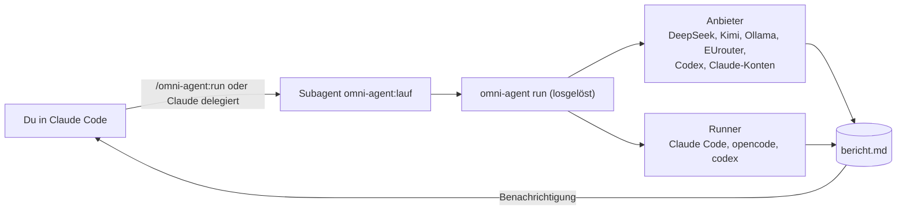

<p align="center">
  
</p>

<p align="center">
  <a href="LICENSE"></a>
  
  
  
  
  
</p>

<p align="center">
  <b>Dein Claude delegiert Aufgaben an andere Modelle, andere Konten und Codex, im Hintergrund, ohne dass du wartest.</b><br>
  DeepSeek, Kimi, Ollama, EUrouter, Codex und beliebig viele Claude-Konten. Ein Befehl, ein Bericht.
</p>

<p align="center">
  <a href="#installieren">Installieren</a> ·
  <a href="#so-sieht-das-aus">Demo</a> ·
  <a href="#was-du-bekommst">Funktionen</a> ·
  <a href="#qualität-je-anbieter">Qualität je Anbieter</a> ·
  <a href="#benutzen">Befehle</a> ·
  <a href="docs/02-architektur.md">Architektur</a> ·
  <a href="CHANGELOG.md">Changelog</a>
</p>

---

## Warum Omni-Agent?

- **Parallel statt nacheinander.** Recherche, Vergleich, Zweitmeinung oder Entwurf laufen im Hintergrund, während dein Haupt-Claude weiterarbeitet. Endet der Lauf, bekommst du eine Benachrichtigung.
- **Das richtige Modell für die Aufgabe.** Billig und schnell mit DeepSeek, lokal und privat mit Ollama, EU-gehostet mit EUrouter, die Zweitmeinung von Codex oder von einem anderen Claude-Konto mit eigenem Kontingent.
- **Claude entscheidet selbst.** Der Subagent `omni-agent:lauf` ist so beschrieben, dass Claude ihn von allein ruft, auch in einem `/goal`. Einen Fremdanbieter wählt Claude nie ungefragt.
- **Sicher gebaut.** Saubere Umgebung je Lauf, nur der eine nötige Schlüssel, Standard ohne Shell, Geheimnis-Sperre im Review. Schlüssel liegen in einer Datei mit Rechten 600 und gehen nie durch den Chat.
- **Null Abhängigkeiten.** Python-Standardbibliothek, ein Plugin, kein Server, keine Datenbank.

## So sieht das aus

*Beispiele, Ausgabe gekürzt.*

```text
> /omni-agent:run --konto felipe Vergleiche drei Methoden zur Qualitätssicherung von Unterricht

● omni-agent:lauf   Lauf 20261111-004456-claude-felipe gestartet (losgelöst)
  … du arbeitest weiter …
● Lauf fertig: bericht.md liegt bereit
  Ergebnis · Befunde · Belege · Annahmen und offene Punkte
```

```text
> /omni-agent:review --konto fbs --adversarial

## Urteil
nacharbeiten, ein kritischer Befund

### [kritisch] Token wird im Log ausgegeben
- Stelle: lib/auth.py:88   - Sicherheit: 0.9
- Empfehlung: Wert vor dem Schreiben schwärzen
```

## Was du bekommst

| | |
|---|---|
| **Delegation von selbst** | Subagent `omni-agent:lauf` übernimmt abgegrenzte Teilaufgaben, `/omni-agent:run` startet ihn auf Zuruf |
| **Läufe im Hintergrund** | Losgelöste Prozesse, `status`, `result`, `cancel`, Benachrichtigung am Ende, Zuordnung zur Claude-Sitzung |
| **Review mit Zweitmeinung** | Git-Diff an ein anderes Modell oder Konto, festes Berichtsschema, `adversarial-review` stellt die Lösung infrage |
| **Projektmodus** | Der Agent arbeitet im echten Projektordner, nur lesend oder mit `--schreibend`, ohne Commit und Push |
| **Review-Gate** | Optional (aus): ein zweites Modell prüft ungeprüfte Änderungen, bevor eine Sitzung endet |
| **Beliebig viele Claude-Konten** | Jedes mit Namen, Schlüssel und eigenem Kontingent, mit Auslastungsanzeige (`/omni-agent:konten`) |
| **Austauschbare Agent-CLI** | Claude Code, opencode, codex, dsh. Omni-Agent prüft, welche CLI zu welchem Anbieter passt |
| **Eigene Anbieter** | Eine JSON-Datei in `~/.omni-agent/providers.d/` genügt |



## Installieren

**Schnellster Weg:** Gib Claude Code diese Repo-Adresse und sage „Installiere mir das". Claude folgt dann [INSTALL.md](INSTALL.md).

**Als Claude-Code-Plugin:**

```text
/plugin marketplace add alexodexo/omni-agent
/plugin install omni-agent@omni-agent
/omni-agent:setup
```

**Ohne Plugin** (auch ohne Claude, im Terminal): Repo klonen, dann `bin/omni-agent setup`. Voraussetzung: Python 3.9 oder neuer (macOS, Linux, WSL) und mindestens eine Agent-CLI (Standard: [Claude Code](https://claude.com/claude-code)).

## Qualität je Anbieter

Läufe, Berichte, Hintergrund, `status`/`result`/`cancel`, Sitzungszuordnung und Review sind **für alle Anbieter dieselbe Strecke**. Unterschiede gibt es nur dort, wo ein Anbieter etwas technisch nicht hergibt:

| Fähigkeit | Claude-Konten | Codex (Anmeldung) | DeepSeek, Kimi, Ollama, OpenRouter | EUrouter, Nvidia |
|---|:-:|:-:|:-:|:-:|
| Lauf im Hintergrund, Bericht, Benachrichtigung | ✅ | ✅ | ✅ | ✅ |
| Auf einem anderen Rechner ausführen (`--host`) | ✅ | ✅ | ✅ | ✅ |
| Review und adversarial Review | ✅ | ✅ | ✅ | ✅ |
| Nachfrage an denselben Agenten (`--fortsetzen`) | ✅ | ✅ | ✅ mit Runner `claude` | – |
| **Projektmodus** (im echten Projekt, lesend oder schreibend) | ✅ | ✅ | ✅ | ✅ |
| Nutzung und Guthaben anzeigen (`/omni-agent:nutzung`) | ✅ Limits | ✅ Limits, Plan, Gutschriften | ✅ Guthaben (DeepSeek, Kimi, OpenRouter) | ✅ Guthaben (EUrouter) |
| **Live getestet** | ✅ | ✅ | nur DeepSeek | nein |

Der Projektmodus gilt für jeden Anbieter, die Entscheidung liegt bei dir. Er sendet Dateien deines Projekts an den gewählten Anbieter; den Datenort zeigt `omni-agent anbieter`. Was „live getestet" heißt und was nur nach Herstellerdoku gebaut ist, steht in der [Anbietertabelle](#anbieter-und-datenschutz).

## Benutzen

| Befehl im Claude-Chat | Zweck |
|---|---|
| `/omni-agent:run [--hintergrund\|--vordergrund] [--konto NAME \| --anbieter ID] [--projekt] [--schreibend] [--fortsetzen\|--neu] <auftrag>` | Auftrag an einen Lauf mit anderem Modell, anderem Claude-Konto oder Codex. Standard: im Hintergrund, du wirst benachrichtigt |
| `/omni-agent:review [--base main] [--konto NAME] [Schwerpunkt]` | Git-Änderungen von einem anderen Modell prüfen lassen (Urteil, Befunde nach Schwere) |
| `/omni-agent:adversarial-review [Schwerpunkt]` | Dasselbe, aber gegnerisch: stellt die gewählte Lösung infrage |
| `/omni-agent:status [lauf] [--alle]` | Tabelle der Läufe dieser Sitzung |
| `/omni-agent:result [lauf]` | Bericht eines Laufs, unverändert |
| `/omni-agent:cancel [lauf]` | Laufenden Lauf abbrechen |
| `/omni-agent:nutzung [ziel]` | Nutzung und Guthaben aller Anbieter: Claude-Limits, Codex-Limits samt Plan, DeepSeek-, Kimi-, OpenRouter-, EUrouter-Guthaben |
| `/omni-agent:hosts [test NAME]` | Fernziele (Mac mini, Server) für `--host` |
| `/omni-agent:konten` | Claude-Konten mit Auslastung (5 Stunden, 7 Tage) und Standard |
| `/omni-agent:setup [--anbieter ID] [--review-gate an\|aus]` | Einrichtung, Anleitung für einen Anbieter, Review-Gate |
| `/omni-agent:doctor` | Was ist da, was fehlt |

### Wie Claude mit Omni-Agent arbeitet

Diese Dateien im Plugin legen fest, **wie** Claude mit Omni-Agent umgeht (es gibt keine zentrale „Anleitungsdatei"; in einem Plugin wird `CLAUDE.md` nicht geladen):

| Datei | Rolle |
|---|---|
| `agents/lauf.md` | Der Subagent `omni-agent:lauf`: ein dünner Weiterleiter. **Seine Beschreibung ist der Auslöser**: Claude darf ihn von selbst rufen, wenn eine größere, abgegrenzte Teilaufgabe an ein anderes Modell, Konto oder Codex gehen soll. Du musst „Omni-Agent" nicht sagen, auch in einem `/goal` nicht. Einen Fremdanbieter wählt Claude nie von sich aus |
| `commands/*.md` | Die Slash-Befehle. `run` ruft den Subagenten, `status`, `result`, `cancel`, `doctor`, `konten` führen den Befehl direkt aus (kein Modell dazwischen) |
| `skills/omni-agent-laufzeit` | Interner Vertrag des Subagenten: genaue Befehlssyntax, Warteschleife, Projektmodus |
| `skills/omni-agent-auftrag` | Interne Anleitung, wie ein Auftrag geschrieben wird (Ziel, Kontext, Erledigt-Kriterium, Grenzen) |
| `skills/omni-agent-ergebnis` | Interne Regeln, wie Ergebnisse weitergegeben werden (Befunde zuerst, Vermutungen kenntlich, nach einem Review anhalten, bei Fehlern keinen Ersatz erfinden) |
| `hooks/hooks.json` | Ordnet Läufe einer Claude-Sitzung zu, räumt beim Beenden auf, optionales Review-Gate |

**Läufe gehören zur Sitzung.** `status`, `result`, `cancel` und die Rückfrage „fortsetzen oder neu?" beziehen sich zuerst auf Läufe der aktuellen Claude-Sitzung. Endet die Sitzung, werden ihre noch laufenden Läufe beendet (bei `/clear` nicht); Berichte bleiben liegen.

**Projektmodus.** `--projekt` lässt den Agenten im Projektordner arbeiten (nur lesend; `--schreibend` erlaubt Änderungen, ohne Commit und Push). Das geht mit jedem Anbieter; bei Fremdanbietern gehen die gelesenen Dateien an deren Datenort. Der Bericht ist die Schlussantwort des Agenten; im Projekt bleibt keine Berichtsdatei zurück.

**Review-Gate (aus, solange du es nicht einschaltest).** `/omni-agent:setup --review-gate an`: Vor dem Beenden einer Claude-Sitzung prüft das Standardkonto jeden neuen Stand ungeprüfter Änderungen und kann das Beenden einmal aufhalten. Ohne Änderungen wird kein Modell gerufen; derselbe Diff wird nie zweimal geprüft, höchstens drei Blockaden je Sitzung, bei Geheimnissen im Diff oder Störungen wird durchgelassen. Das kostet Nutzung, und der Diff verlässt den Rechner.

Im Terminal:

```bash
omni-agent run --anbieter deepseek --text "Vergleiche drei Methoden zur Qualitätssicherung von Unterricht"
omni-agent run --anbieter nvidia --runner opencode auftrag.md
omni-agent status
omni-agent result                         # Bericht des letzten Laufs
omni-agent run --fortsetzen --text "Und wie sieht es bei X aus?"   # Nachfrage an denselben Agenten
omni-agent cancel                         # laufenden Lauf abbrechen
omni-agent review --konto fbs --base main --adversarial   # Zweitmeinung zu den Änderungen im Repo
omni-agent run --hintergrund --konto felipe --text "…"   # losgelöst starten, Laufname kommt sofort
omni-agent warte --max 540                               # auf den Lauf warten, dann Stand oder Bericht
omni-agent run --projekt --konto fbs --text "Warum hängt der Login?"   # im aktuellen Projekt, nur lesend
```

**Review:** `omni-agent review` schickt den Git-Diff (alle Änderungen gegen HEAD, bei sauberem Arbeitsbaum der Branch gegen den Hauptzweig, oder `--base main`) an ein anderes Modell oder Konto und liefert Urteil (`freigeben` oder `nacharbeiten`), Befunde nach Schwere mit Datei, Zeile und Sicherheit sowie nächste Schritte. `--adversarial` stellt zusätzlich die gewählte Lösung infrage, ein freier Text danach legt den Schwerpunkt fest. Der Diff verlässt den Rechner: `--vorschau` zeigt vorher, was gesendet würde. Enthält der Diff mögliche Geheimnisse oder `.env`-Dateien, wird **nichts** gesendet (nur `--trotzdem` überstimmt das). Lock-Dateien und Dateien über 400 KB Diff werden ausgenommen. Der Reviewer ändert nichts am Code; Befunde sind Hinweise, keine Wahrheit.

**Nachfragen:** `--fortsetzen` setzt den Lauf mit demselben Agentenverlauf fort (Claude und Codex), im selben Ordner; `bericht.md` wird aktualisiert. Anbieter und Runner bleiben die des Laufs.

## Nutzung und Guthaben

`omni-agent nutzung` (oder `/omni-agent:nutzung`) zeigt, was der jeweilige Anbieter hergibt, alle Abfragen laufen parallel:

```text
claude-fbs       5 Std 2%, Reset Mi 03:00 (in 1 Std 25 Min)  |  7 Tage 73%, Reset Do 10:00 (in 1 Tg 8 Std)
codex            Plan prolite  |  7 Tage 1% genutzt, Reset Mo 16.11. 23:20 (in 5 Tg 21 Std)  |  2 Reset-Gutschriften verfügbar
deepseek         Guthaben 9.18 USD (aufgeladen 9.18)
```

| Anbieter | Quelle | Angezeigt |
|---|---|---|
| Claude-Konten | Rate-Limit-Header einer Ein-Token-Anfrage | Auslastung 5 Stunden und 7 Tage mit Reset, bei API-Schlüsseln freie Anfragen und Tokens |
| Codex | `codex app-server` (Anmeldung der Codex-CLI selbst) | Plan, Auslastung je Zeitfenster mit Reset, Guthaben, Reset-Gutschriften, Sperre |
| DeepSeek, Kimi, OpenRouter, EUrouter | Guthaben-Abfrage des Anbieters | Guthaben mit Währung |
| Ollama, Nvidia, eigene Anbieter | – | steht ausdrücklich „keine Abfrage bekannt" bzw. „läuft lokal" |

Der Schlüssel geht nur an den Anbieter, dem er gehört. Live geprüft: Claude-Konten, Codex und DeepSeek. Kimi, OpenRouter und EUrouter sind nach deren Dokumentation gebaut. Mit `--host mini` fragst du die Konten und Anmeldungen auf einem anderen Rechner ab.

## Auf anderen Rechnern ausführen

Mac mini, Linux-Server, Cloud-VM: alles, was `ssh` erreicht. Tailscale-Adressen und MagicDNS-Namen gehen genauso (auch Tailscale SSH ohne Schlüssel). Der Befehl läuft **dort**; Schlüssel, Agent-CLIs, Projekte und Läufe bleiben dort, es wird nichts übertragen.

```bash
omni-agent host add mini --ssh alex@mini.tailnet-name.ts.net    # oder eine Tailscale-IP
omni-agent host install mini      # holt Omni-Agent per git nach ~/.omni-agent-app auf dem Ziel
omni-agent host setup mini        # Schlüssel und Anmeldungen dort einrichten (im eigenen Terminal)
omni-agent host test mini         # ssh erreichbar, Runner, Anbieter

omni-agent run --host mini --anbieter codex --warten 540 --text "Fasse die Logs zusammen"
omni-agent run --host mini --projekt ~/projekte/app --konto fbs --text "Warum hängt der Login?"
omni-agent status --host mini
omni-agent nutzung --host mini
```

- `--host` geht mit `run`, `status`, `result`, `cancel`, `warte`, `nutzung` und `doctor`. Hintergrund, Benachrichtigung und `--warten` funktionieren wie lokal; läuft die ssh-Verbindung ab, läuft der Lauf auf dem Ziel weiter.
- Mit `--projekt` ist der Ordner ein Pfad **auf dem Ziel**. `--material` und `review` brauchen lokale Dateien und gehen mit `--host` nicht.
- Eine lokale Auftragsdatei wird als Text mitgeschickt.
- Voraussetzung auf dem Ziel: Python 3.9 oder neuer, `git` (nur für `host install`) und eine Agent-CLI. Anmeldung per Schlüssel oder Tailscale SSH, ohne Passwortabfrage.
- Live geprüft: Mac mini über Tailscale-Adresse mit Codex-Anmeldung.

**Claude in der Cloud:** `claude --cloud` startet eine Sitzung bei Anthropic gegen ein GitHub-Repository. Das ist ein anderes Modell als ein Lauf mit Bericht und deshalb noch kein `--host`-Ziel. Ein eigener Cloud-Rechner (VM mit ssh) funktioniert dagegen schon heute.

## Schlüssel: nie im Chat

Schlüssel liegen in `~/.omni-agent/env` (Zeile `NAME=wert`, Rechte 600) oder in einer Umgebungsvariable. `omni-agent setup` legt die Datei an; **du trägst den Schlüssel selbst ein**. Claude fragt nie danach und liest die Datei nie aus. Omni-Agent verweigert die Datei, wenn andere sie lesen könnten.

## Anbieter und Datenschutz

**Alles, was du in einen Auftrag schreibst, geht an den Anbieter.** Schicke keine Teilnehmerdaten, Zugangsdaten oder Interna an einen Anbieter, dessen Datenort du nicht akzeptierst.

| Anbieter | Format | Datenort | Live getestet | Schlüssel |
|---|---|---|---|---|
| **deepseek** | Anthropic | **China**, Training vorgesehen | ja | `DEEPSEEK_API_KEY` |
| **openrouter** | Anthropic | nicht belegt | nein | `OPENROUTER_API_KEY` |
| **kimi** | Anthropic | nicht belegt | nein | `MOONSHOT_API_KEY` |
| **ollama** | Anthropic | **lokal**, bleibt auf dem Rechner | nein | keiner |
| **eurouter** | OpenAI | EU (laut Anbieter) | nein | `EUROUTER_API_KEY` |
| **nvidia** | OpenAI (nur Chat) | nicht belegt | nein | `NVIDIA_API_KEY` |
| **claude-konto** | Anthropic | Anthropic | nein | `ANTHROPIC_API_KEY` |
| **codex** (OpenAI-Anmeldung) | OpenAI | OpenAI | ja | keiner: `codex login` |
| **claude-NAME** (eigene Konten) | Anthropic | Anthropic | nein | `OMNI_AGENT_KONTO_NAME` |

„Nein" heißt: nach Herstellerdokumentation eingebaut (Stand 28.10.2026), aber nicht von uns ausprobiert. Für Personenbezug: `ollama` oder `eurouter`. Eigene Anbieter: JSON-Datei in `~/.omni-agent/providers.d/` (gleiches Schema wie [providers.json](providers.json)).

### Codex (OpenAI)

`--anbieter codex` nutzt **die Anmeldung der Codex-CLI selbst**, also dein ChatGPT-Konto oder deinen OpenAI-Schlüssel aus `codex login`. Omni-Agent speichert dafür nichts. Voraussetzung: `codex` ist installiert und angemeldet; `omni-agent doctor` zeigt „angemeldet". Findet es `codex` nicht im PATH, sucht es in der ChatGPT-App (`/Applications/ChatGPT.app/…/codex-cli`); mit `OMNI_AGENT_CODEX=/Pfad/zu/codex` legst du den Ort selbst fest.

- Es gelten **nur** die Anmeldung, nicht deine persönliche `config.toml` und deine Regeln (`--ignore-user-config --ignore-rules`). Modell und Aufwand gibst du an: `--modell klein|standard|stark` oder ein Modellname, `--aufwand low|medium|high`.
- Codex läuft in seinem Sandkasten (`workspace-write`): schreiben nur im Laufordner, kein Netz für Shell-Befehle. Seine Shell ist deshalb immer da und steht in der Werkzeugzeile.
- Dein Codex-Kontingent zählt mit. Mit `luna` (`--modell klein`) und `--aufwand low` bleibt es billig.
- Codex mit einem **Fremdanbieter** (z. B. EUrouter über die Responses-API) ist gebaut, aber nicht live geprüft.

### Claude-Konten mit Namen

So viele Konten, wie du willst, jedes mit eigenem Namen und eigenem Kontingent:

```bash
omni-agent konto add felipe --art token --titel "Felipes Konto"   # fragt den Schlüssel unsichtbar ab
omni-agent konto add fps --art api
omni-agent konto list                                              # zeigt auch die Nutzung (Limits)
omni-agent run --anbieter claude-felipe --text "…"                # oder /omni-agent:run claude-fps …
omni-agent konto remove fps --mit-schluessel
```

- **Name:** Kleinbuchstaben, Ziffern, Bindestrich. Der Anbieter heißt dann `claude-<name>`, der Schlüssel steht in `~/.omni-agent/env` als `OMNI_AGENT_KONTO_<NAME>` (Rechte 600).
- **Art:** `api` ist empfohlen (`ANTHROPIC_API_KEY`). Ein Abo-Token (`--art token`, `CLAUDE_CODE_OAUTH_TOKEN`) für unbeaufsichtigte Läufe ist bei Anthropic nicht ausdrücklich geregelt; ob das erlaubt ist, ist **nicht belegt**. Die Entscheidung liegt bei dir.
- **Schlüssel nie in den Chat.** `konto add` fragt im eigenen Terminal ab, oder du trägst die Zeile selbst in die Datei ein. Eine schon vorhandene Zeile übernimmst du mit `--uebernehme CLAUDE_CODE_OAUTH_TOKEN`.
- **Nutzung in `konto list`:** je Abo-Konto Auslastung der 5-Stunden- und 7-Tage-Grenze samt Rücksetzzeit, bei API-Schlüsseln die freien Anfragen und Tokens. Das kostet eine Ein-Token-Anfrage je Konto (Haiku) und wird aus den Rate-Limit-Headern gelesen; `--ohne-nutzung` überspringt es. Live geprüft nur für Abo-Token; bei API-Schlüsseln stehen die Headernamen nach Anthropics Doku, ungeprüft. Den Kontotyp (Pro, Max) liefern diese Header nicht. Ein leeres Fenster („5 Std –") heißt: gerade läuft keins.
- **Standard-Konto:** `omni-agent konto standard fbs` legt fest, was ohne `--anbieter` läuft. Kurzform für ein anderes Konto: `--konto felipe`. Fremdanbieter wie DeepSeek werden nie als Standard gewählt, solange du es nicht selbst festlegst.
- Konten laufen nur mit dem Runner `claude`. Der Anbieter `claude-konto` bleibt als Ein-Konto-Kurzweg (`ANTHROPIC_API_KEY`).

## Anbieter und Runner passen zusammen

Jeder Anbieter spricht ein Format, jede CLI versteht nur manche.

| Anbieter | claude | opencode | codex |
|---|---|---|---|
| deepseek, openrouter, kimi, ollama | ja | ja | nein |
| eurouter | nur mit LiteLLM | ja | ja (Responses-Pfad nicht geprüft) |
| nvidia | nur mit LiteLLM | ja | nein |
| claude-konto, claude-NAME | ja | – | – |
| codex (Anmeldung) | – | – | ja |

`omni-agent run` nimmt ohne `--runner` den ersten **installierten** passenden Runner (claude, opencode, codex). `omni-agent doctor` zeigt die Matrix für deinen Rechner. Passt nichts, sagt es dir, was fehlt.

**Runner-Stand:** `claude` und `codex` (mit Anmeldung) sind live getestet. `opencode` und Codex mit Fremdanbieter sind nach Herstellerdokumentation gebaut, aber nicht ausprobiert. `dsh` (DeepSeek Harness) ist eine Developer Preview und läuft nur, wenn du `--runner dsh` ausdrücklich nennst.

### Optional: LiteLLM als Übersetzer

Nur nötig, wenn Claude Code gegen einen reinen OpenAI-Anbieter laufen soll. Meist ist `--runner opencode` der bessere Weg. `omni-agent extras litellm install` legt LiteLLM in eine eigene Umgebung (fest gepinnte Version, Hash-Prüfung); gestartet wird es mit `--ueber-litellm`. Der Proxy lauscht nur auf 127.0.0.1 und bekommt nur den einen Schlüssel des Anbieters. Hintergrund: Die Version 1.107.0 von LiteLLM war am 21.10.2026 kompromittiert; Omni-Agent pinnt davor.

## Sicherheit

| Maßnahme | Wirkung |
|---|---|
| Saubere Umgebung (`env -i` plus Nötigstes) | Dein Login und deine Base-URL rutschen nicht in den Fremdagenten |
| Nur der eine benötigte Schlüssel | Kein anderer Anbieter-Schlüssel erreicht den Lauf |
| Claude-Runner: `--setting-sources project`, `--strict-mcp-config`, `dontAsk`, leerer Arbeitsordner. Die Sitzung wird gespeichert (für `--fortsetzen`) und enthält den Auftrag, nie Schlüssel | Keine fremden Hooks oder MCP-Server |
| Codex-Runner: `--ignore-user-config --ignore-rules`, Sandbox `workspace-write` | Deine Codex-Einstellungen und Regeln wirken nicht; Schreiben nur im Laufordner |
| Review: Sperre bei Geheimnissen und `.env` im Diff, Vorschau, Größengrenze, nur Lesen und Schreiben | Es geht nichts raus, was du nicht gesehen hast |
| Standard **ohne Shell** | Websuche kann Fremdtext liefern, der den Agenten lenkt. `--werkzeuge +shell` nur bewusst |
| Schlüssel werden in `log.jsonl` und `fehler.log` geschwärzt | Kein Schlüssel im Log |
| Zeitlimit (900 s) und Rundenobergrenze | Ein hängender Lauf wird samt Kindprozessen beendet |

Ein Lauf ist **fertig, wenn `bericht.md` existiert**. Der Exit-Code des Runners ist nur ein Zusatzsignal. Omni-Agent-Exit: 0 fertig, 1 Fehler im Lauf, 2 Konfiguration, 3 Endpunkt nicht erreichbar, 124 Zeitlimit.

Das Ergebnis eines Fremdmodells ist ein Entwurf. Prüfe Aussagen, die der Agent als „nicht belegt" markiert hat. Die „Kosten laut CLI" im Fortschritt rechnet Claude Code mit eigenen Preisen; die echten Kosten stehen beim Anbieter.

## Entwickeln

```bash
python3 -m unittest discover -s tests -v     # Kern, Passung, Runner-Befehle, Ende-zu-Ende mit Attrappe
claude plugin validate --strict .            # Plugin und Marketplace
claude --plugin-dir .                        # Plugin lokal laden, /reload-plugins nach Änderungen
```

Architektur und Hintergründe: [docs/02-architektur.md](docs/02-architektur.md), Plugin-Grundlagen: [docs/01-plugin-handbuch.md](docs/01-plugin-handbuch.md). Mitarbeit für Agenten: [AGENTS.md](AGENTS.md).

## Lizenz

[MIT](LICENSE)
